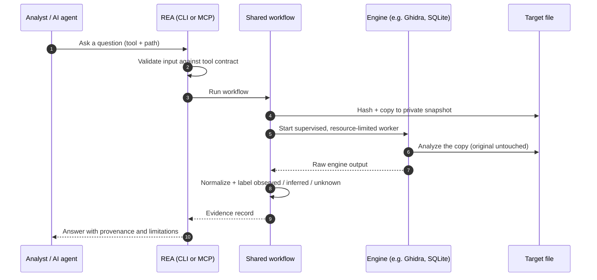

# REA — High-Level Architecture

## 1. Layers

!(./rea_demo/HighLevelDiagram.png)

## 2. One request, end to end

## Key messages

- **Two front doors, one engine room** — CLI and MCP share the same workflows, so results match.
- **REA orchestrates, engines analyze** — Ghidra, JADX, Frida, etc. do the heavy lifting.
- **Everything returns Evidence** — hashes, engine version, limitations, and what is *known* vs *guessed*.
- **Safe by default** — works on copies, bounded workers, target content treated as untrusted.
